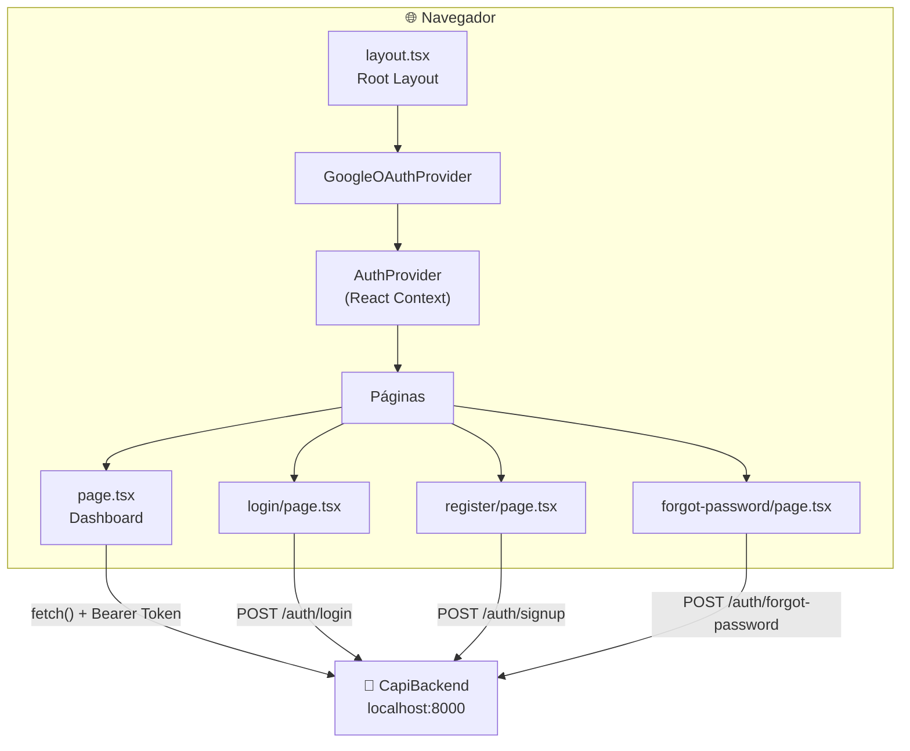
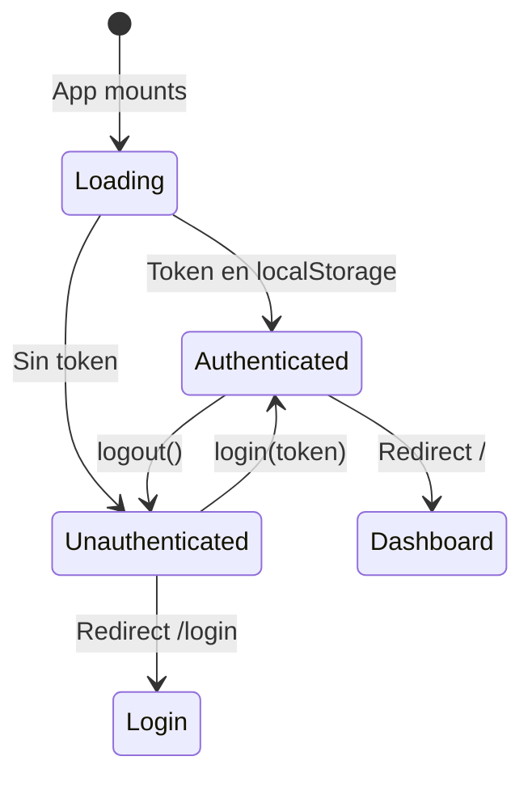

# 🏗️ Arquitectura — CapiFront

## Visión General

CapiFront usa el **App Router** de Next.js 16, con componentes de React 19 renderizados en el cliente (`"use client"`). La aplicación se comunica con el backend de FastAPI via HTTP REST.



---

## Estructura de la Aplicación

### App Router (Next.js 16)

Next.js 16 usa el sistema de **App Router** basado en directorios:

```
app/
├── layout.tsx          → Root layout (se ejecuta en TODAS las rutas)
├── page.tsx            → Ruta: /
├── login/page.tsx      → Ruta: /login
├── register/page.tsx   → Ruta: /register
└── forgot-password/page.tsx → Ruta: /forgot-password
```

Cada `page.tsx` es un **Client Component** (`"use client"`) porque:
- Necesitan estado interactivo (`useState`, `useEffect`)
- Usan hooks del router (`useRouter`)
- Utilizan animaciones de Framer Motion
- Requieren acceso a `localStorage` para tokens JWT

### Providers (layout.tsx)

El Root Layout envuelve toda la app con dos providers:

```
<html>
  <body>
    <GoogleOAuthProvider>    ← SDK de Google OAuth2
      <AuthProvider>          ← Context de autenticación Cápi
        {children}            ← Páginas
      </AuthProvider>
    </GoogleOAuthProvider>
  </body>
</html>
```

---

## Gestión de Estado

### Componentes de UI (`components/`)
Diseño basado en Atomic Design pero simplificado a componentes presentacionales puros:
- **`BottomNav.tsx`**: Menú de navegación inferior fijado, exclusivo para dispositivos móviles (`md:hidden`). Garantiza una experiencia UX premium tipo "App" en teléfonos.
- **`Sidebar.tsx`**: Menú lateral de navegación, exclusivo para pantallas grandes (`hidden md:flex`).
- **`SummaryCards.tsx`**: Tarjetas animadas que muestran el total de ingresos, gastos y balance.
- **`MovementsList.tsx`**: Tabla de transacciones con soporte para borrado, reutilizable en dashboard y vistas completas.
- **`charts/IncomeExpenseChart.tsx`**: Gráfico circular (Recharts) que ilustra la proporción de gastos vs ingresos, diseñado de manera fluida y escalable.
- **Modales (`modals/`)**: Construidos sobre un componente base `Modal.tsx` responsivo con control de scroll (`max-h-[90vh]`), para centralizar la creación y edición de entidades.

### AuthContext

El estado de autenticación se gestiona con un **React Context** global:



**Estado expuesto**:
- `user`: Objeto usuario (placeholder actual)
- `token`: JWT almacenado en localStorage
- `loading`: Flag de inicialización
- `login(token)`: Guarda token y redirige al dashboard
- `logout()`: Limpia token y redirige al login

### Estado Local (Dashboard)

El dashboard principal (`page.tsx`) maneja su propio estado local con múltiples `useState` para:
- Estados de modales (agregar movimiento, meta, presupuesto)
- Estados de formularios
- Vista de secciones activas
- Configuración de perfil

---

## Comunicación con el Backend

### Patrón de Fetch

Todas las llamadas al backend siguen este patrón:

```typescript
const response = await fetch('http://localhost:8000/api/v1/endpoint', {
  method: 'POST',
  headers: {
    'Content-Type': 'application/json',
    'Authorization': `Bearer ${token}`
  },
  body: JSON.stringify(data)
});

if (response.ok) {
  const result = await response.json();
  // Actualizar estado
} else {
  // Manejar error
}
```

### Endpoints Consumidos

| Frontend Page | Backend Endpoint | Descripción |
|---|---|---|---|
| Login | `POST /auth/login` | Autenticación email/password |
| Login | `POST /auth/google-login` | Autenticación Google OAuth2 |
| Register | `POST /auth/signup` | Registro |
| Forgot Password | `POST /auth/forgot-password` | Recuperación |
| Dashboard | `GET /dashboard/` | Datos completos |
| Dashboard | `POST /movements/` | Crear movimiento |
| Dashboard | `DELETE /movements/{id}` | Eliminar movimiento |
| Dashboard | `POST /goals/` | Crear meta |
| Dashboard | `DELETE /goals/{id}` | Eliminar meta |
| Dashboard | `POST /goals/bulk-allocate/` | Asignar a metas |
| Dashboard | `POST /budgets/` | Crear presupuesto |
| Dashboard | `DELETE /budgets/{id}` | Eliminar presupuesto |
| Dashboard | `GET /categories/` | Listar categorías |
| Dashboard | `POST /users/profile-picture` | Actualizar perfil |

---

## Sistema de Estilos

### TailwindCSS v4

La aplicación usa TailwindCSS v4 con el plugin PostCSS:

```mjs
// postcss.config.mjs
const config = {
  plugins: {
    "@tailwindcss/postcss": {},
  },
};
```

No se usa archivo `tailwind.config.js` — TailwindCSS v4 detecta las clases automáticamente.

### Variables CSS

Definidas en `globals.css` con soporte para dark mode:

```css
:root {
  --background: #ffffff;
  --foreground: #171717;
}

@media (prefers-color-scheme: dark) {
  :root {
    --background: #0a0a0a;
    --foreground: #ededed;
  }
}
```

### Design System

La app utiliza un diseño dark-mode premium con:
- Fondo: `#0a0a0a` (near-black)
- Cards: `#121212` con border `#1e1e1e`
- Inputs: `#181818` con bordes sutiles
- Acentos: azul `#3b82f6`, verde `#22c55e`, púrpura `#8b5cf6`
- Gradientes y efectos de glow para profundidad visual

---

## Tipografía

Usa las fuentes de Google **Geist** (sans-serif) y **Geist Mono** cargadas via `next/font/google` para optimización automática.
